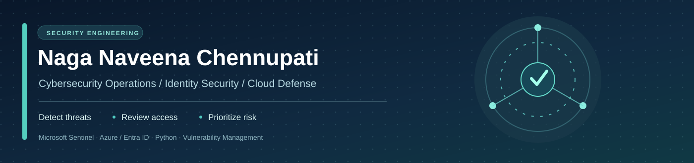
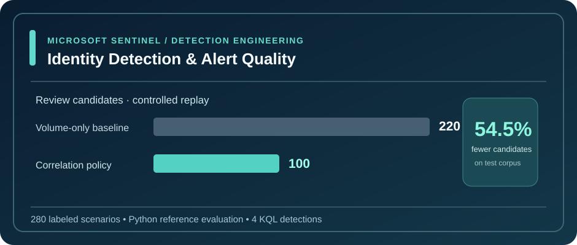
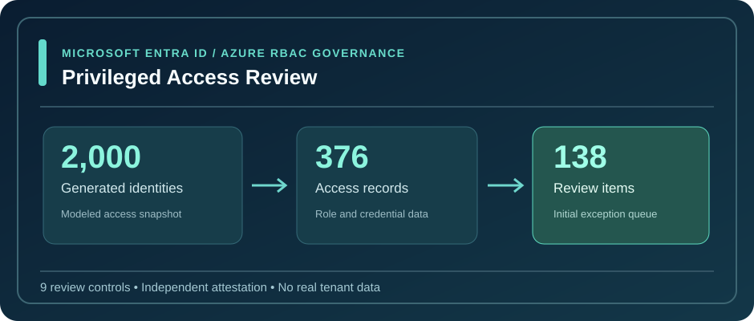

<!-- GitHub profile README. Displayed when published in the public naveenachennupati/naveenachennupati repository. -->

### Turning security signals into explainable, actionable decisions

**Cybersecurity Analyst | Security Operations & Incident Response | Microsoft Sentinel | Azure & Identity Security**

I am a Cybersecurity Analyst and former Security Engineer with 7+ years of combined experience across SOC monitoring, incident investigation, infrastructure security, identity governance and Microsoft Azure. My focus is translating technical evidence into decisions the security and infrastructure teams can act on: **what happened, what matters, who should act, and how we verify it**.

My background includes security operations at **UnitedHealth Group** (Cyber Security Analyst) and infrastructure security engineering at **SSPart Enterprise** (Security Engineer), working with Microsoft Sentinel, Azure environments, Microsoft Entra ID, Qualys, Windows, Linux, and Active Directory. I also build open, reviewable security engineering tools with documented assumptions, tests, and audit evidence.

**Chicago, Illinois · Open to relocation · Full-time / contract opportunities · No employer sponsorship required**

[**Portfolio website**](https://naveenachennupati.github.io/) &nbsp;·&nbsp; [**LinkedIn**](https://www.linkedin.com/in/chnaveena/) &nbsp;·&nbsp; [**Email**](mailto:chennu.naveena@gmail.com) &nbsp;·&nbsp; [**GitHub repositories**](https://github.com/naveenachennupati?tab=repositories)

### Professional scope

| Security operations | Incident investigations | Identity governance |
| :--- | :--- | :--- |
| **150+ security alerts / week** monitored and investigated in Microsoft Sentinel | **30+ incidents / quarter** supported across Azure environments | **2,000+ users and service accounts** in Entra ID / RBAC access-review scope |

*Work experience figures provided from my professional background; the engineering projects below are independent artifacts.*

### Selected security engineering work

Every project starts with a security operations problem, documents the implementation, and includes a repeatable evidence trail. **Project evaluation figures describe controlled studies unless otherwise noted.**

<table>
<tr><td width="44%" valign="top"></td><td valign="top">
<b>01 · Microsoft Sentinel Detection Engineering &amp; Identity Threat Analytics</b>  
<b>Problem:</b> Isolated authentication thresholds produce repetitive review candidates without enough context.  
<b>Engineering:</b> Four MITRE-mapped KQL rules, Bicep release definitions, triage playbooks, Python regression tests, and an explicit change-control process.  
<b>Measured study:</b> In 280 labeled scenarios, a Python correlation policy selected <b>100 candidates vs. 220</b> under a volume-only baseline (<b>54.5% fewer</b>), with equal recall on that constructed corpus. This is <i>not</i> a production Sentinel measurement.  
<a href="https://github.com/naveenachennupati/sentinel-detection-engineering"><b>Explore code and documentation</b></a> · <a href="https://github.com/naveenachennupati/sentinel-detection-engineering/blob/main/reports/outcome-study.json">Evidence JSON</a> · <a href="https://github.com/naveenachennupati/sentinel-detection-engineering/actions">CI results</a>
</td></tr>
<tr><td valign="top"></td><td valign="top">
<b>02 · Microsoft Entra ID Identity Governance &amp; Privileged Access Assessment</b>  
<b>Problem:</b> Privileged role assignments, guests, service principals, and Azure RBAC permissions are difficult to review consistently across separate sources.  
<b>Engineering:</b> Read-only Microsoft Graph / Azure ARM collection, nine policy checks, owner/approver attestations, time-limited exceptions, and role-drift review.  
<b>Measured study:</b> A generated 2,000-identity workload contained <b>376 access records</b>, producing <b>138 distinct first-pass review items</b>. These are not confirmed tenant violations.  
<a href="https://github.com/naveenachennupati/entra-access-governance"><b>Explore code and documentation</b></a> · <a href="https://github.com/naveenachennupati/entra-access-governance/blob/main/reports/operational-study.json">Evidence JSON</a>
</td></tr>
<tr><td valign="top"></td><td valign="top">
<b>03 · Risk-Based Vulnerability Management &amp; Exploit Intelligence Automation</b>  
<b>Problem:</b> CVSS-only queues can overlook known-exploited vulnerabilities and ignore asset context or missing intelligence.  
<b>Engineering:</b> Official CISA KEV ingestion, optional FIRST EPSS enrichment, Qualys/Trivy adapters, priority explanations, source-completeness checks, and remediation governance.  
<b>Measured study:</b> A defined 240-row hypothetical asset/CVE scenario includes <b>80 KEV-positive rows below CVSS 7</b>; the public evidence contains <b>7 documented KEV CVEs</b>. The modeled rows are <i>not</i> actual scanner findings.  
<a href="https://github.com/naveenachennupati/kev-exposure-prioritization"><b>Explore code and documentation</b></a> · <a href="https://github.com/naveenachennupati/kev-exposure-prioritization/blob/main/reports/operational-study.json">Evidence JSON</a>
</td></tr>
</table>

### How I approach security engineering

**Evidence before conclusions.** Capture the source, state assumptions, and preserve enough context to reproduce the result. **Controls before automation.** Keep privilege reviews read-only, require independent approvals for exceptions, and separate detection rule validation from activation. **Operational usefulness.** Prefer understandable alert signals, prioritized owner queues, and actionable remediation decisions over dashboards without clear next steps.

### Security skills and technologies

| Area | Relevant platforms, practices and methods |
| --- | --- |
| **SOC & detection** | Microsoft Sentinel, SIEM, KQL, alert triage, log correlation, MITRE ATT&CK, investigation documentation |
| **Incident response & forensics** | Containment coordination, compromised credentials, event timeline reconstruction, endpoint forensics support, evidence handling, root-cause analysis |
| **Cloud & identity** | Azure, Defender for Cloud, Microsoft Entra ID, Active Directory, IAM, RBAC, privileged access reviews, least-privilege governance |
| **Vulnerability management** | Qualys, CVSS, CISA KEV, FIRST EPSS, risk-based prioritization, vulnerability assessments, remediation tracking |
| **Security engineering** | Python, detection-as-code, Azure Bicep, Microsoft Graph / ARM API integrations, Git, GitHub Actions, regression tests, security evidence reports |
| **Systems & assurance** | Windows Server, Linux, endpoint/server logs, HIPAA, SOC 2 audit evidence, access governance, security control documentation |

Research topics include AI for cybersecurity, IoT, 6G networks, quantum cryptography and secure satellite communications. See the complete [skills and experience profile](https://naveenachennupati.github.io/#skills).

### Research and education

Author/co-author of **nine IEEE conference papers (2026)** spanning AI-enabled cybersecurity, cloud security, autonomous cyber defense, IoT, and secure communications. Selected publications: [Secure Cloud Networking](https://ieeexplore.ieee.org/abstract/document/11744772) · [AI-Driven Cyber Defense](https://ieeexplore.ieee.org/document/11708173) · [Cybersecurity for Satellite Networks](https://ieeexplore.ieee.org/document/11744920).

M.S. in Computer Science, Governors State University. Pursuing a PhD in Information Technology (Computer Science concentration), University of the Cumberlands.

### Contact

**From security signals to decisions teams can act on.** I connect investigation evidence, cloud posture, identity access and vulnerability intelligence to clear, accountable security actions. My focus is understanding what matters, coordinating the response, and validating the outcome.

**Focus:** Security Operations · Incident Response · Microsoft Sentinel · Azure / Entra ID Security · IAM / RBAC · Vulnerability Management

**Availability:** Open to full-time and contract cybersecurity opportunities · Chicago, Illinois

[**Portfolio**](https://naveenachennupati.github.io/) &nbsp;·&nbsp; [**LinkedIn**](https://www.linkedin.com/in/chnaveena/) &nbsp;·&nbsp; [**Email**](mailto:chennu.naveena@gmail.com)

**Resume:** [Download current resume (PDF)](https://naveenachennupati.github.io/downloads/Naga_Naveena_Chennupati_Resume.pdf) · **Location:** Chicago, Illinois · **Mobility:** Open to relocation · **Sponsorship:** Not required.
