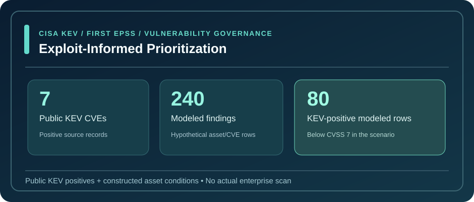

<!-- GitHub profile README. Displayed when published in the public naveenachennupati/naveenachennupati repository. -->

### Turning security signals into explainable, actionable decisions

**Cybersecurity Analyst | SOC & Incident Response | Microsoft Sentinel | Azure & Entra ID Security | Vulnerability Management**

I work across threat detection, incident investigation, identity governance, and cloud security. My focus is connecting the technical evidence to a clear security decision: **what happened, what matters, who should act, and how we verify it**.

My background includes security operations at **UnitedHealth Group** and security engineering at **SSPart Enterprise**, working with Microsoft Sentinel, Azure environments, Microsoft Entra ID, Qualys, Windows, Linux, and Active Directory. I also build open, reviewable security engineering tools with documented assumptions, tests, and audit evidence.

[**LinkedIn**](https://www.linkedin.com/in/naveenachenn) &nbsp;·&nbsp; [**Email**](mailto:chennu.naveena@gmail.com) &nbsp;·&nbsp; [**GitHub repositories**](https://github.com/naveenachennupati?tab=repositories)

### Professional scope

| Security operations | Incident investigations | Identity governance |
| :--- | :--- | :--- |
| **150+ security alerts / week** monitored and investigated in Microsoft Sentinel | **30+ incidents / quarter** supported across Azure environments | **2,000+ users and service accounts** in Entra ID / RBAC access-review scope |

*Work experience figures provided from my professional background; the engineering projects below are independent artifacts.*

### Selected security engineering work

Every project starts with a security operations problem, documents the implementation, and includes a repeatable evidence trail. **Project evaluation figures describe controlled studies unless otherwise noted.**

<table>
<tr><td width="44%" valign="top"></td><td valign="top">
<b>01 · Microsoft Sentinel Detection Engineering &amp; Identity Threat Analytics</b>  
<b>Problem:</b> Isolated authentication thresholds produce repetitive review candidates without enough context.  
<b>Engineering:</b> Four MITRE-mapped KQL rules, Bicep release definitions, triage playbooks, Python regression tests, and an explicit change-control process.  
<b>Measured study:</b> In 280 labeled scenarios, a Python correlation policy selected <b>100 candidates vs. 220</b> under a volume-only baseline (<b>54.5% fewer</b>), with equal recall on that constructed corpus. This is <i>not</i> a production Sentinel measurement.  
<a href="https://github.com/naveenachennupati/sentinel-detection-engineering"><b>Explore code and documentation</b></a> · <a href="https://github.com/naveenachennupati/sentinel-detection-engineering/blob/main/reports/outcome-study.json">Evidence JSON</a> · <a href="https://github.com/naveenachennupati/sentinel-detection-engineering/actions">CI results</a>
</td></tr>
<tr><td valign="top"></td><td valign="top">
<b>02 · Microsoft Entra ID Identity Governance &amp; Privileged Access Assessment</b>  
<b>Problem:</b> Privileged role assignments, guests, service principals, and Azure RBAC permissions are difficult to review consistently across separate sources.  
<b>Engineering:</b> Read-only Microsoft Graph / Azure ARM collection, nine policy checks, owner/approver attestations, time-limited exceptions, and role-drift review.  
<b>Measured study:</b> A generated 2,000-identity workload contained <b>376 access records</b>, producing <b>138 distinct first-pass review items</b>. These are not confirmed tenant violations.  
<a href="https://github.com/naveenachennupati/entra-access-governance"><b>Explore code and documentation</b></a> · <a href="https://github.com/naveenachennupati/entra-access-governance/blob/main/reports/operational-study.json">Evidence JSON</a>
</td></tr>
<tr><td valign="top"></td><td valign="top">
<b>03 · Risk-Based Vulnerability Management &amp; Exploit Intelligence Automation</b>  
<b>Problem:</b> CVSS-only queues can overlook known-exploited vulnerabilities and ignore asset context or missing intelligence.  
<b>Engineering:</b> Official CISA KEV ingestion, optional FIRST EPSS enrichment, Qualys/Trivy adapters, priority explanations, source-completeness checks, and remediation governance.  
<b>Measured study:</b> A defined 240-row hypothetical asset/CVE scenario includes <b>80 KEV-positive rows below CVSS 7</b>; the public evidence contains <b>7 documented KEV CVEs</b>. The modeled rows are <i>not</i> actual scanner findings.  
<a href="https://github.com/naveenachennupati/kev-exposure-prioritization"><b>Explore code and documentation</b></a> · <a href="https://github.com/naveenachennupati/kev-exposure-prioritization/blob/main/reports/operational-study.json">Evidence JSON</a>
</td></tr>
</table>

### How I approach security engineering

**Evidence before conclusions.** Capture the source, state assumptions, and preserve enough context to reproduce the result. **Controls before automation.** Keep privilege reviews read-only, require independent approvals for exceptions, and separate detection rule validation from activation. **Operational usefulness.** Prefer understandable alert signals, prioritized owner queues, and actionable remediation decisions over dashboards without clear next steps.

**Core stack:** Microsoft Sentinel · KQL · Azure · Microsoft Entra ID · Microsoft Graph · Azure RBAC · MITRE ATT&CK · Incident Response · Qualys · Microsoft Defender for Cloud · Python · CISA KEV · FIRST EPSS · HIPAA / SOC 2 evidence support

### Research and education

Author/co-author of **nine IEEE conference papers (2026)** spanning AI-enabled cybersecurity, cloud security, autonomous cyber defense, IoT, and secure communications. Selected publications: [Secure Cloud Networking](https://ieeexplore.ieee.org/abstract/document/11744772) · [AI-Driven Cyber Defense](https://ieeexplore.ieee.org/document/11708173) · [Cybersecurity for Satellite Networks](https://ieeexplore.ieee.org/document/11744920).

M.S. in Computer Science, Governors State University. Pursuing a PhD in Information Technology (Computer Science concentration), University of the Cumberlands.

### Contact

**Interested in:** Cybersecurity Analyst II/III, SOC Analyst, Security Engineer, Azure Security, IAM / Identity Security, and Vulnerability Management roles.

[**Connect on LinkedIn**](https://www.linkedin.com/in/naveenachenn) &nbsp;·&nbsp; [**Email me**](mailto:chennu.naveena@gmail.com)

Transparency: The featured GitHub engineering artifacts include generated test scenarios and public intelligence sources. The projects are not represented as customer deployments or production employer systems. Access to actual Azure tenants and enterprise scanner outputs requires separate authorization.
